# Cartiva — Product Requirements Document

| | |
|---|---|
| **Product** | Cartiva — Intelligent Grocery Shopping Platform |
| **Repository** | `cartiva-ai` |
| **Version** | 2.0 |
| **Date** | October 2026 |
| **Status** | Manual shopping MVP built · Voice + payment in progress |
| **Related docs** | [SRS-PRD.md](SRS-PRD.md) (original requirements) · [PLAN.md](PLAN.md) (phased build plan) · [CLAUDE.md](CLAUDE.md) (architecture rules) |

> Diagrams are written in Mermaid. They render on GitHub and in VS Code (with a Mermaid preview extension).

---

## 1. Overview

### 1.1 Problem

Grocery apps make users browse, search and tap through many screens to build a basket. Voice assistants exist, but most are chatbots bolted onto an app — they talk *about* the store instead of operating it, and their state drifts from what the screen shows.

### 1.2 Product

Cartiva is a grocery web app that can be used two ways, at any moment, on the same cart:

- **Manual** — browse categories, search, filter, add to cart, check out.
- **Voice** — speak naturally ("add 2 kg potatoes", "which one is cheapest?", "checkout") and a real-time AI agent performs the same actions in the app.

### 1.3 Core principle

> **Cartiva is not a voice chatbot. It is a grocery shopping application with voice as an additional interface.**

Both interfaces call the **same controllers and services** and change the **same state**. Anything the voice agent does is visible in the UI immediately, and anything the user does manually is known to the agent.

---

## 2. Goals, Non-Goals and Success Metrics

### 2.1 Goals

| # | Goal |
|---|---|
| G1 | A polished, responsive grocery store that works fully without voice. |
| G2 | Real-time voice shopping via LiveKit that operates the app through approved tools. |
| G3 | One source of truth for catalog, cart, pricing and checkout rules. |
| G4 | Safe conversational behaviour: no guessing on ambiguity, no payment without explicit confirmation. |
| G5 | Razorpay payment with server-side verification. |
| G6 | Clean, explainable architecture (MVC + SOLID) suitable for a portfolio review. |

### 2.2 Non-Goals (v1)

- Database, user accounts or authentication.
- Real inventory, warehouse or delivery tracking.
- Multi-vendor marketplace or recommendation models.
- Autonomous payment without user confirmation.

### 2.3 Success metrics

| Metric | Target |
|---|---|
| End-to-end demo (browse → voice → checkout → verified payment) | Completes without manual workaround |
| Voice tool success on the demo script (§14) | 10 / 10 |
| UI reflects a voice action | < 500 ms after the tool returns |
| Ambiguous request resolved by guessing | 0 occurrences |
| Payment started without explicit "yes" | 0 occurrences |
| Lighthouse accessibility score | ≥ 90 |
| Layout from 320 px to 1440 px+ | No horizontal scroll, no overlap |

---

## 3. Users

| Persona | Need | How Cartiva serves it |
|---|---|---|
| **Quick shopper** | Fill a basket fast | Category rails, search, one-tap "Add" that becomes a stepper |
| **Hands-busy shopper** | Shop while cooking or multitasking | Voice commands with spoken confirmations |
| **Careful shopper** | Know what they pay | Live bill breakdown, offer hints, explicit confirmation before payment |
| **Reviewer / recruiter** | Judge engineering quality | Visible MVC layers, typed action results, shared state between voice and UI |

---

## 4. Scope and Release Status

| Area | Feature | Status |
|---|---|---|
| Catalog | 67 products, 9 categories, 4 offers in JSON | ✅ Done |
| Discovery | Home, category pages, product detail, search, filters, sort | ✅ Done |
| Cart | Add / remove / steppers / clear, stock limits, persisted in localStorage | ✅ Done |
| Pricing | Subtotal, per-category and cart-wide offers, delivery fee, offer hints | ✅ Done |
| Checkout | Validation, explicit confirmation, mock payment, failure + retry, order success page | ✅ Done (mock gateway) |
| Design | Monochrome grey / black theme, responsive, accessible | ✅ Done |
| Backend | FastAPI skeleton (`GET /api/health`) | 🟡 Started |
| Voice | LiveKit session, agent worker, RPC bridge, voice states | ⬜ Phase 6 |
| Voice tools | 12 tools over shared services | ⬜ Phase 7 |
| Context | References, ambiguity, cancellation, interruption | ⬜ Phase 8 |
| Payment | Razorpay order + Checkout.js + signature verification | ⬜ Phase 9 |
| Quality | Vitest + pytest, shared golden pricing cases | ⬜ Phase 11 |

---

## 5. System Architecture

Cartiva has three runtime parts and no database.

| Part | Tech | Responsibility |
|---|---|---|
| **Frontend** | Next.js 16 (App Router), React 19, TypeScript, Tailwind v4, Zustand | UI, JSON catalog, search/filter, cart state, pricing, checkout flow, RPC handlers for the agent, Razorpay Checkout.js |
| **Backend** | Python 3.12, FastAPI | LiveKit token, Razorpay order creation (total recomputed server-side), payment signature verification |
| **Agent worker** | Python, LiveKit Agents | Speech-to-text → LLM → text-to-speech, voice tools, conversation context |

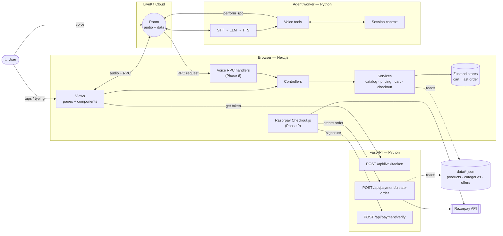

### 5.1 Architecture rules

1. **The agent never owns a cart or catalog.** Every voice tool calls a browser RPC method, which calls the same controller/service the manual UI uses.
2. **The browser pushes UI context to the agent** (current category, displayed products, cart snapshot) so "the cheapest one" works after manual browsing.
3. **The browser reports payment results to the agent** so it can announce success or failure.
4. **The agent never executes payment.** It can only ask the browser to open checkout after explicit confirmation.
5. **FastAPI owns all secrets.** The browser only receives a LiveKit token and the Razorpay key ID.
6. **Payment totals are recomputed on the server** from `data/*.json`. A client-sent total is never trusted.

---

## 6. Code Architecture — MVC + SOLID

The frontend follows strict MVC layering. Mutations always flow **View → Controller → Service → Storage interface → Store**.

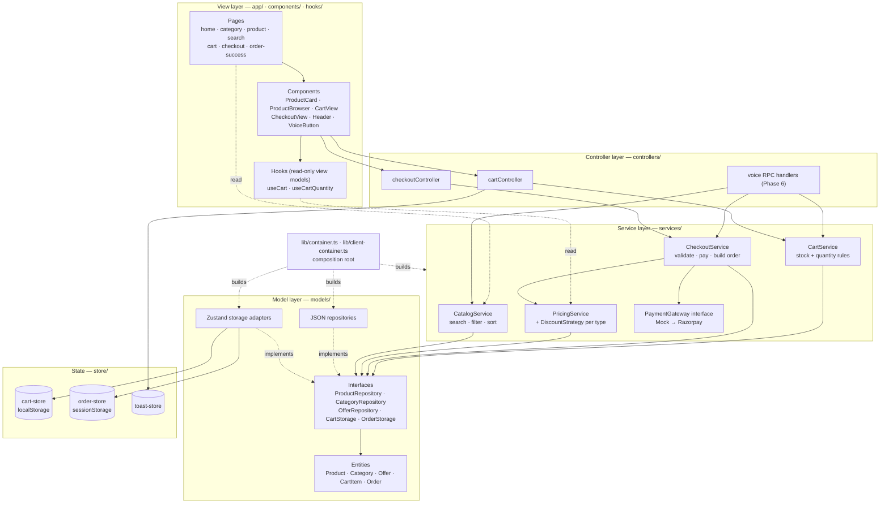

| Principle | How it is applied |
|---|---|
| **S** — Single responsibility | Repositories only read data, services only hold rules, stores only hold state, views only render. |
| **O** — Open/closed | New discount type = new `DiscountStrategy`. Razorpay = new `PaymentGateway`. No existing class changes. |
| **L** — Liskov substitution | `MockPaymentGateway` and the future `RazorpayPaymentGateway` are interchangeable; JSON repositories can be swapped for database repositories. |
| **I** — Interface segregation | Small interfaces: `ProductRepository`, `OfferRepository`, `CartStorage`, `OrderStorage`, `PaymentGateway`. |
| **D** — Dependency inversion | Services receive interfaces through constructors; only the composition root knows concrete classes. |

### 6.1 Repository layout

```text
cartiva-ai/
├── app/                     # View — routes (App Router)
├── components/              # View — UI components
├── hooks/                   # View — read-only view models
├── controllers/             # Controller — UI / voice entry points
├── services/                # Business rules
│   ├── catalog-service.ts
│   ├── cart-service.ts
│   ├── checkout-service.ts
│   ├── pricing/             # PricingService + discount strategies
│   └── payment/             # PaymentGateway + MockPaymentGateway
├── models/
│   ├── entities/            # Product, Category, Offer, Cart, Order
│   └── repositories/        # interfaces, JSON repos, Zustand adapters, validator
├── store/                   # Zustand state containers
├── lib/                     # container.ts, client-container.ts, format.ts
├── types/                   # cross-cutting: ActionResult, VoiceState
├── data/                    # products.json, categories.json, offers.json
└── backend/                 # Python (uv): FastAPI app + LiveKit agent worker
```

---

## 7. Complete Flow Diagrams

### 7.1 Master flow — one app, two interfaces

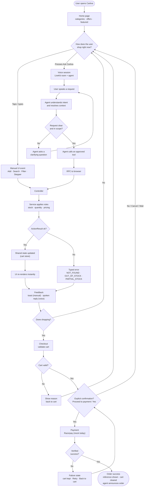

### 7.2 Route and navigation map

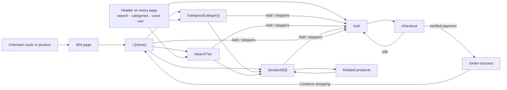

### 7.3 Manual shopping journey

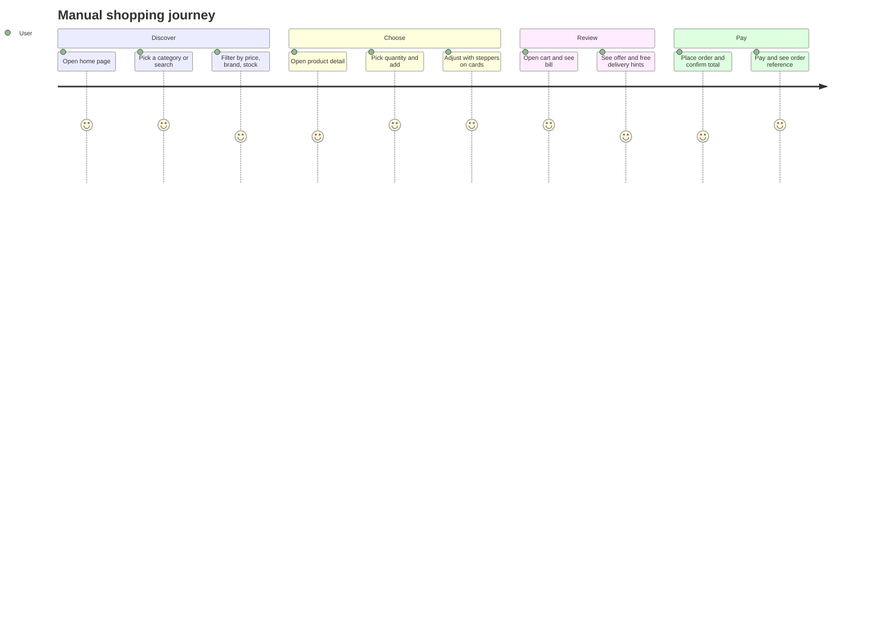

### 7.4 Add-to-cart rule flow (shared by UI and voice)

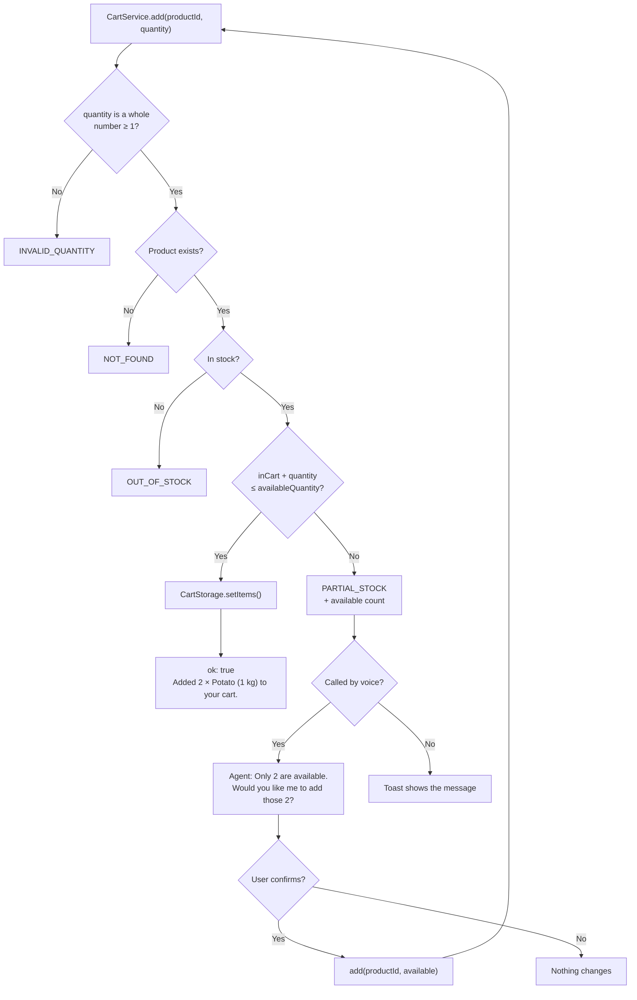

### 7.5 Voice session lifecycle

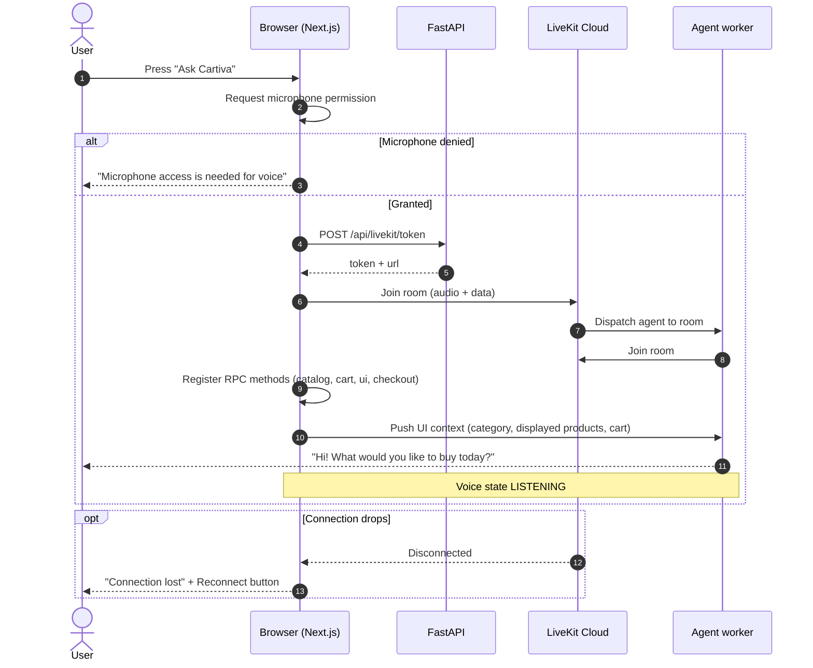

### 7.6 Voice command → tool → shared action

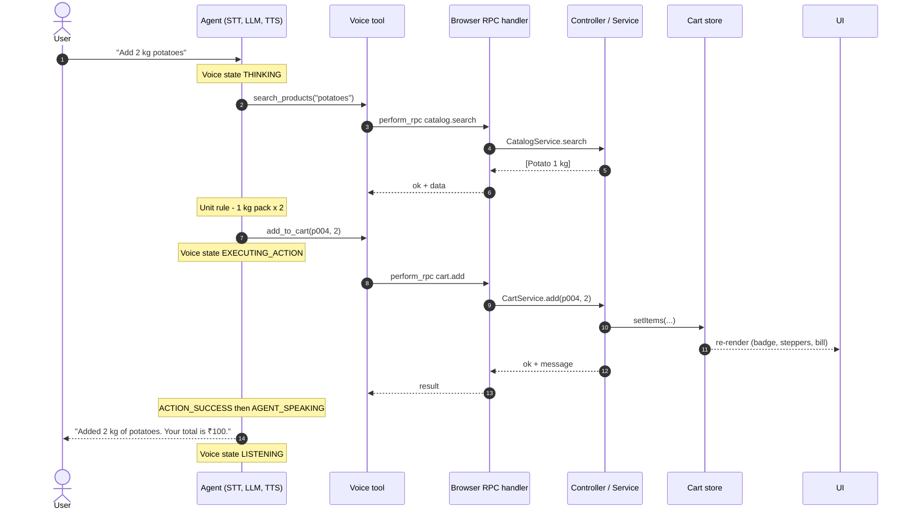

### 7.7 Context, ambiguity and references

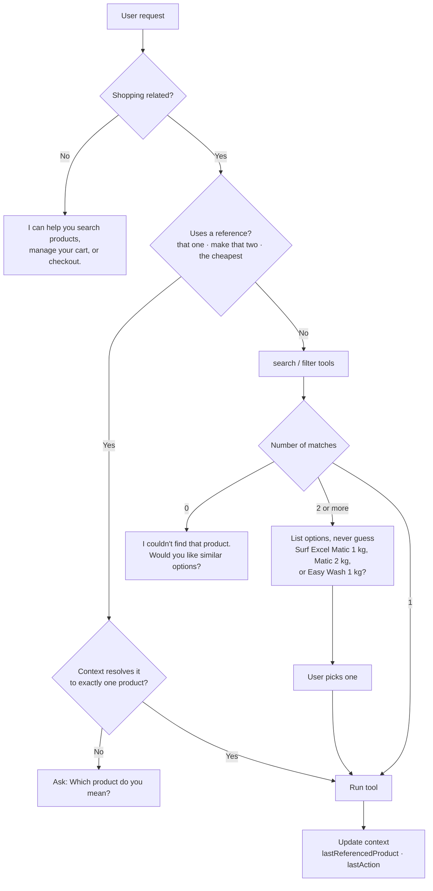

**Context the agent keeps** (`backend/agent/context.py`):

| Field | Source | Example |
|---|---|---|
| `currentCategory` | Browser push | `cleaning` |
| `lastSearch` | Agent | `"dishwashing liquid"` with max ₹200 |
| `lastDisplayedProducts` | Browser push | 4 products on screen |
| `currentCart` | Browser push | items + pricing snapshot |
| `lastReferencedProduct` | Agent | `p045` (cheapest) |
| `lastAction` | Agent | `add_to_cart(p004, 1)` |
| `pendingConfirmation` | Agent | `{ type: "checkout", total: 495 }` |

The agent never invents context. If a reference can't be resolved to exactly one product, it asks.

### 7.8 Voice assistant state machine

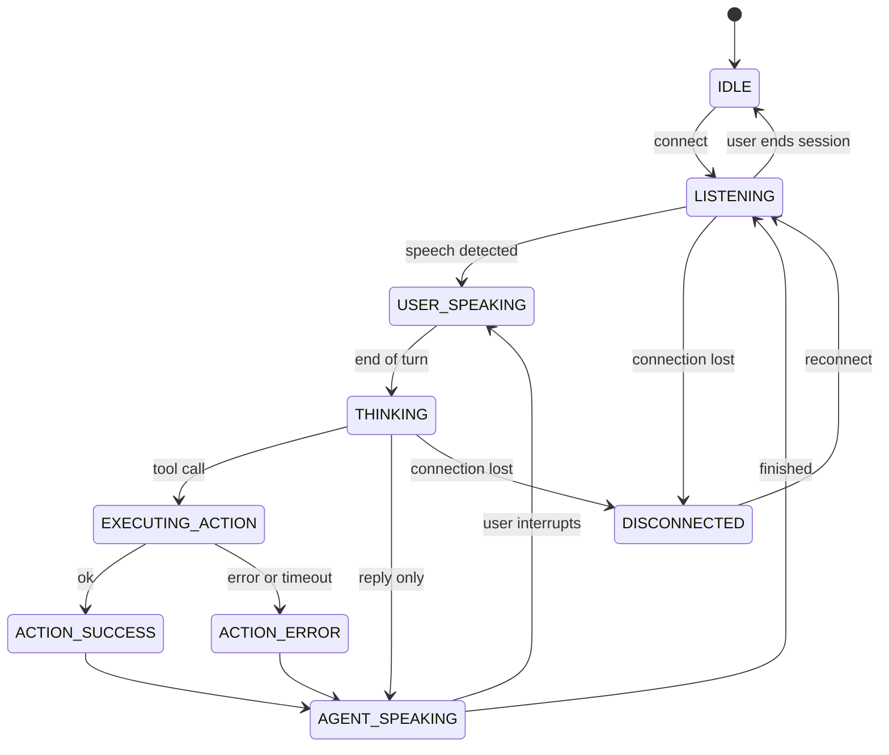

| State | UI label |
|---|---|
| IDLE | 🎤 Ask Cartiva |
| LISTENING | 🎤 Listening… |
| USER_SPEAKING | 🎤 Listening… (live transcript) |
| THINKING | ✨ Thinking… |
| EXECUTING_ACTION | 🛒 Adding to cart… |
| ACTION_SUCCESS | ✓ Added to cart |
| ACTION_ERROR | ⚠ Something went wrong |
| AGENT_SPEAKING | 🔊 Speaking… |
| DISCONNECTED | ⚠ Connection lost · Reconnect |

### 7.9 Checkout confirmation states (implemented)

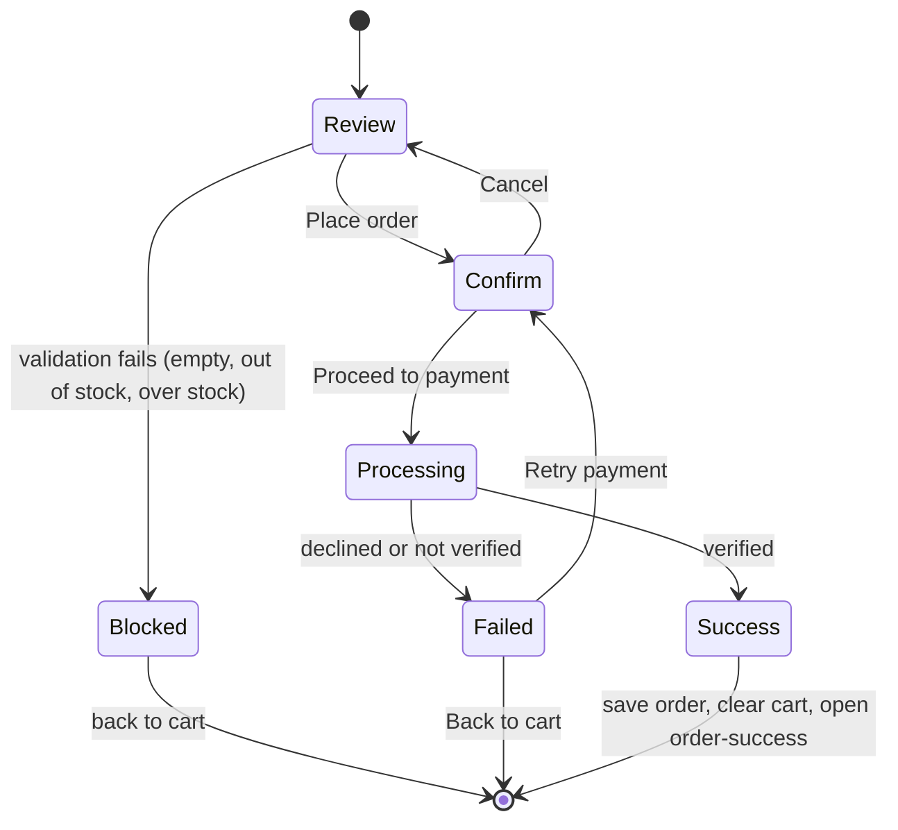

### 7.10 Checkout and payment — voice + Razorpay (Phase 9)

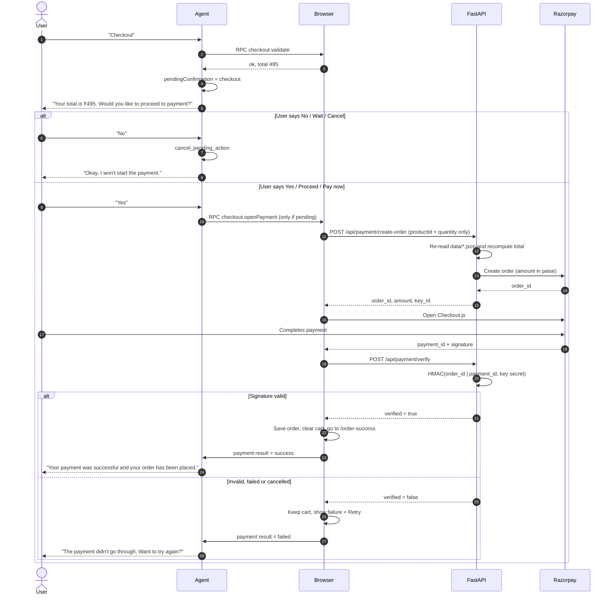

---

## 8. Functional Requirements

| ID | Requirement | Status |
|---|---|---|
| FR-01 | Homepage: header, search, categories, featured products, offers, cart access, voice control | ✅ |
| FR-02 | Product catalog loaded from JSON (id, name, category, description, price, unit, brand, stock, availableQuantity, image, tags) | ✅ |
| FR-03 | Category list, category pages, navigation between categories | ✅ |
| FR-04 | Partial-match search by name, brand, category, tags (handles plurals) | ✅ |
| FR-05 | Filter by query, category, price range, brand, availability; sort | ✅ |
| FR-06 | Product detail: image, name, brand, price, unit, description, availability, quantity selector, add to cart | ✅ |
| FR-07 | Cart: add, remove, increase, decrease, update, clear, subtotal, discounts, delivery fee, total | ✅ |
| FR-08 | One cart shared by UI and voice | ✅ UI · ⬜ voice |
| FR-09 | Deterministic pricing in the service layer | ✅ |
| FR-10 | Offers from JSON; only active, eligible offers apply | ✅ |
| FR-11 | LiveKit voice connection with visible status | ⬜ |
| FR-12 | Voice states (§7.8) | ⬜ (types defined) |
| FR-13 | Natural commands: search, category, filter, add, remove, quantity, cart, bill, checkout, cancel | ⬜ |
| FR-14 | Approved tool set only (§9) | ⬜ |
| FR-15 | Session context (§7.7); never invent context | ⬜ |
| FR-16 | Contextual references ("that one", "make that two", "the cheapest") | ⬜ |
| FR-17 | Ambiguous products → ask, never pick randomly | ⬜ |
| FR-18 | Partial stock → offer the available quantity and wait for confirmation | ✅ rule · ⬜ voice |
| FR-19 | Empty search → say so and offer alternatives | ✅ UI · ⬜ voice |
| FR-20 | Out-of-scope requests → redirect to shopping help | ⬜ |
| FR-21 | Interruption during agent speech | ⬜ |
| FR-22 | Checkout validation: non-empty, valid quantities, available stock, total calculated | ✅ |
| FR-23 | Explicit confirmation before payment | ✅ UI · ⬜ voice |
| FR-24 – FR-25 | Razorpay order → checkout → verification | ⬜ (mock gateway in place) |
| FR-26 | On verified success: success screen, order reference, clear cart, agent confirms | ✅ UI · ⬜ agent |
| FR-27 | On failure: not marked paid, failure state, retry, return to cart | ✅ |

---

## 9. Voice Tools

Every tool is a thin Python wrapper (`backend/agent/tools.py`) that calls a browser RPC method. No business rules live in the agent.

| Tool | Input | Browser service call | Notes |
|---|---|---|---|
| `search_products` | `query` | `CatalogService.search` | Updates `lastDisplayedProducts` |
| `filter_products` | `query?, category?, min_price?, max_price?, brand?, available?` | `CatalogService.filter` | "under ₹200" → `max_price: 200` |
| `navigate_category` | `category` | router push | Updates `currentCategory` |
| `open_product` | `product_id` | router push | "Show me that one" |
| `add_to_cart` | `product_id, quantity` | `CartService.add` | Returns `PARTIAL_STOCK` with `available` |
| `remove_from_cart` | `product_id` | `CartService.remove` | |
| `update_cart` | `product_id, quantity` | `CartService.updateQuantity` | 0 removes the item |
| `get_cart` | — | `CartService.getCart` | Lines + pricing |
| `get_cart_total` | — | `PricingService.calculate` | Subtotal, discount, delivery, total |
| `start_checkout` | — | `CheckoutService.validate` | Sets `pendingConfirmation`; never pays |
| `confirm_payment` | — | opens Razorpay in the browser | Rejected unless a confirmation is pending |
| `cancel_pending_action` | — | clears `pendingConfirmation` | "No", "wait", "never mind" |

---

## 10. Data Model

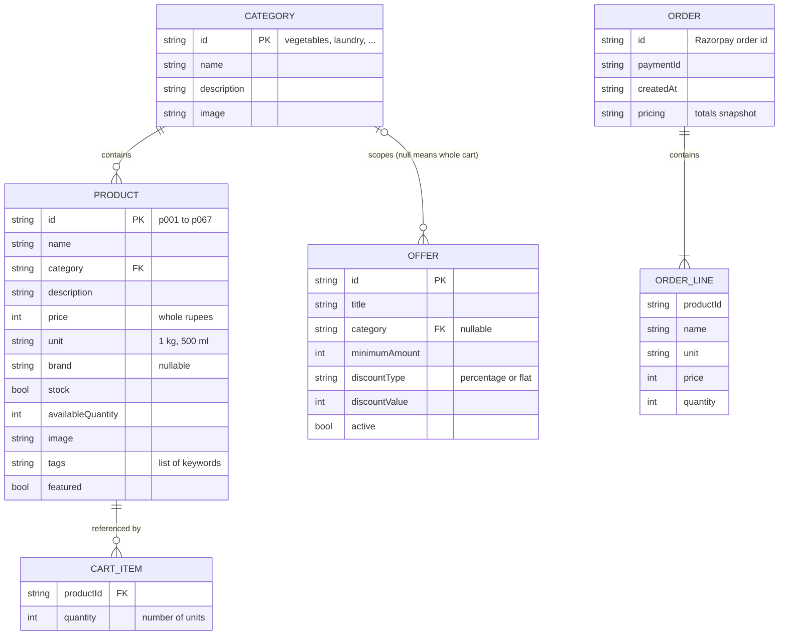

### 10.1 Catalog contents

| Category | Products | Demo coverage |
|---|---|---|
| Vegetables | 11 | "tom" → Tomato, Tomato Cherry, Tomato Puree; Coriander out of stock |
| Fruits | 7 | Mango Alphonso has only 2 left; Papaya out of stock |
| Dairy | 7 | Milk, butter, paneer, eggs |
| Beverages | 7 | Tea, coffee, juices |
| Snacks | 7 | Chips, namkeen, biscuits |
| Breakfast | 5 | Cereals, bread, jam, ketchup |
| Cleaning | 9 | 4 dishwashing liquids under ₹200 (cheapest: Vim 250 ml at ₹55) + one at ₹299 |
| Laundry | 7 | Surf Excel Matic 1 kg / 2 kg / Easy Wash 1 kg (ambiguity); Easy Wash only 2 left; Ariel out of stock |
| Personal Care | 7 | Soap, toothpaste, shampoo |

### 10.2 Pricing rules

```text
Subtotal  = Σ price × quantity
Discount  = Σ eligible offers (capped at subtotal)
            · percentage: round(eligible amount × value / 100)
            · flat: min(value, eligible amount)
            · eligible amount = category subtotal, or cart subtotal when category is null
            · applies only when active and eligible amount ≥ minimumAmount
Delivery  = ₹0 if subtotal ≥ ₹499 (or cart empty), else ₹30
Total     = Subtotal − Discount + Delivery
```

| Offer | Rule |
|---|---|
| `offer001` 10% OFF | Vegetables ≥ ₹300 |
| `offer002` 15% OFF Laundry | Laundry ≥ ₹500 |
| `offer003` ₹50 OFF | Cart ≥ ₹999 |
| `offer004` 20% OFF Fruits | Inactive (must never apply) |

**Quantity rule:** `quantity` always counts units of the product's pack size. "2 kg potatoes" with a 1 kg pack → quantity 2. If both 1 kg and 2 kg packs exist, ask.

---

## 11. Error Codes

One set of codes is shared by services, RPC results, FastAPI responses and voice replies. Each result carries a `message` that can be shown or spoken as-is.

| Code | Meaning | Status |
|---|---|---|
| `NOT_FOUND` | Product doesn't exist | ✅ |
| `NOT_IN_CART` | Update or remove on an item not in the cart | ✅ |
| `OUT_OF_STOCK` | Product unavailable | ✅ |
| `PARTIAL_STOCK` | Fewer units available than requested (`available` included) | ✅ |
| `INVALID_QUANTITY` | Not a whole number ≥ 1 | ✅ |
| `EMPTY_CART` | Checkout with nothing in the cart | ✅ |
| `PAYMENT_FAILED` | Payment declined or cancelled | ✅ |
| `AMBIGUOUS` | Several products match a voice request | ⬜ |
| `PENDING_CONFIRMATION_REQUIRED` | `confirm_payment` called without a pending checkout | ⬜ |
| `PAYMENT_VERIFICATION_FAILED` | Razorpay signature invalid | ⬜ |

---

## 12. Non-Functional Requirements

| Area | Requirement |
|---|---|
| **Performance** | Catalog pages are statically prerendered (84 pages). Cart updates are instant, with no reload. Voice actions show visible progress. |
| **Responsiveness** | 320 px → 1440 px+. Product grid goes from 2 to 5 columns; horizontal rails on mobile. |
| **Accessibility** | Semantic landmarks, skip link, labelled controls, visible focus ring, `aria-live` for cart counts and toasts, full keyboard access. |
| **Reliability** | Every failure has a user-facing message: unknown product, no results, stock limits, empty cart, payment failure, backend unreachable, microphone denied, LiveKit down. Manual shopping keeps working if the backend or LiveKit is down. |
| **Security** | No secrets in the frontend or Git. Payment verified server-side. Client totals never trusted. Agent limited to approved tools. |
| **Maintainability** | MVC + SOLID (§6). TypeScript strict mode. ESLint clean. Catalog validated at startup. |
| **Hydration safety** | Persisted stores rehydrate after mount to avoid server/client mismatches. |

---

## 13. Design System

Monochrome grey and black. No pure-white surfaces and no colourful accents. Red is used only for errors and destructive actions.

| Token | Value | Used for |
|---|---|---|
| `background` (canvas) | `#dcdcdf` | Page background |
| `surface` | `#ececee` | Cards, panels, inputs |
| `surface-muted` | `#e0e0e3` | Image tiles, hints, secondary fills |
| `zinc-900` | `#18181b` | Header, footer, hero, offer cards |
| `brand-600 / 700` | `#18181b / #09090b` | Primary buttons, steppers, links |
| `zinc-300` | `#d4d4d8` | Borders and dividers |
| `red-600` | `#dc2626` | Errors, "Clear cart", remove |

Product images are emoji placeholders on `surface-muted` until real photos are added to `public/products/`.

---

## 14. Acceptance Criteria and Demo Script

### 14.1 Demo script (must pass end to end)

| # | User says / does | Expected result |
|---|---|---|
| 1 | "Show me vegetables." | Vegetables page opens |
| 2 | "Add 1 kg tomatoes and 2 kg potatoes." | Cart: Tomato × 1, Potato × 2; agent confirms |
| 3 | "Show me dishwashing liquids under ₹200." | 4 products shown |
| 4 | "Which one is cheapest?" | Agent names Vim 250 ml at ₹55 |
| 5 | "Add that one." | Vim 250 ml added |
| 6 | "What's my bill?" | Correct subtotal, discount, delivery and total |
| 7 | "Add Surf Excel." | Agent lists 3 options and waits |
| 8 | "Checkout." | "Your total is ₹X. Would you like to proceed to payment?" |
| 9 | "No." | Payment does not start |
| 10 | "Checkout" → "Yes." | Razorpay opens; verified success → order page; agent announces |
| — | Interrupt the agent mid-sentence | Agent stops and handles the new request |

### 14.2 MVP checklist

- [x] Browse, search, filter and sort products manually
- [x] Product details, add with quantity, stock limits enforced
- [x] Cart edit / remove / clear; correct pricing with offers and delivery
- [x] Checkout validation, explicit confirmation, failure + retry, success page
- [x] Responsive, accessible, monochrome UI
- [x] No database; secrets not committed
- [ ] Voice connects via LiveKit and shows its state
- [ ] Voice agent searches, filters, navigates, adds, removes, updates, reads cart and bill
- [ ] Agent handles ambiguity, unavailable items, partial stock, references, interruption
- [ ] Voice checkout requires explicit confirmation
- [ ] Razorpay payment works; success verified server-side; failure handled
- [ ] Automated tests (Vitest + pytest) pass
- [ ] Deployed (frontend, FastAPI, agent worker)

---

## 15. Risks and Open Questions

| Risk / question | Impact | Mitigation |
|---|---|---|
| Pricing exists in TypeScript (UI) and Python (payment) | Totals could drift | Shared golden cases in `data/pricing-cases.json` run by Vitest and pytest; use integer paise |
| Delivery fee and threshold live in `lib/container.ts`, not JSON | Python port could miss a change | Move to a `data/` config file before Phase 9 |
| STT / LLM / TTS provider not chosen | Blocks Phase 6 | Decide at the start of Phase 6; document env vars |
| LLM picks a product on ambiguity | Wrong item added | Tools return `AMBIGUOUS` with options; prompt forbids guessing; demo test #7 |
| Agent worker hosting | Vercel can't run long-lived workers | LiveKit Cloud Agents, Railway or Fly.io |
| Browser tab closed during a voice session | Agent loses its RPC target | Agent detects the participant leaving and ends the session |
| `PLAN.md` §1.2 still shows the older `lib/*` layout | Confusing for contributors | Update it to the MVC layout in §6.1 |

---

## 16. Roadmap

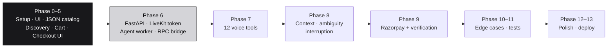

**After v1:** user accounts, persistent orders, database, smart shopping lists ("buy my usual"), recommendations, coupons, multilingual voice, delivery tracking.

---

## 17. Definition of Success

A reviewer sees one continuous experience:

```text
Browse manually → switch to voice → ask naturally → AI understands context
→ AI runs real app actions → UI changes instantly → AI reports the result
→ checkout → explicit confirmation → verified payment → order success
```

**Voice is an interface to the application, not a separate chatbot.**
