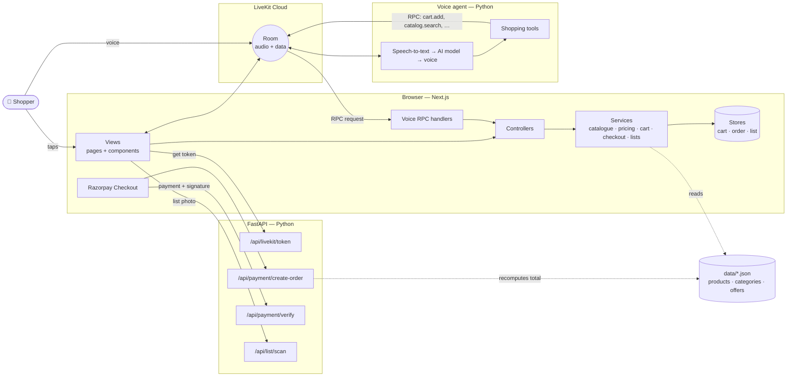
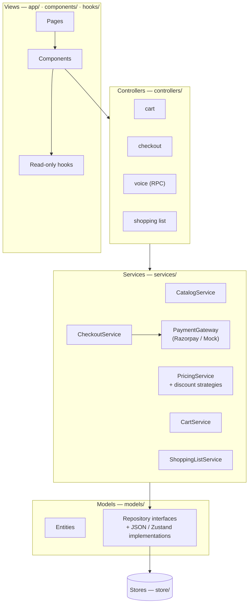
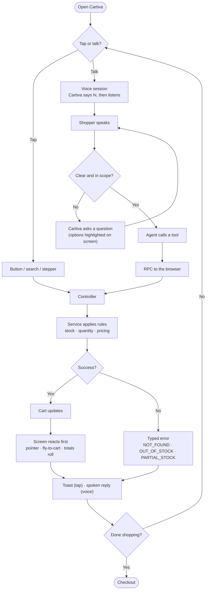
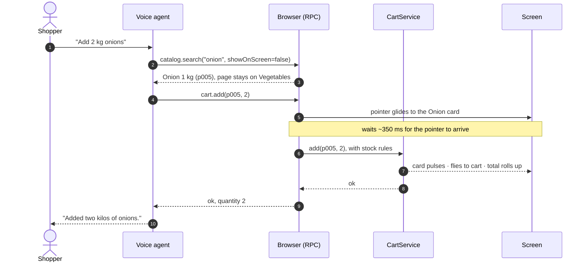
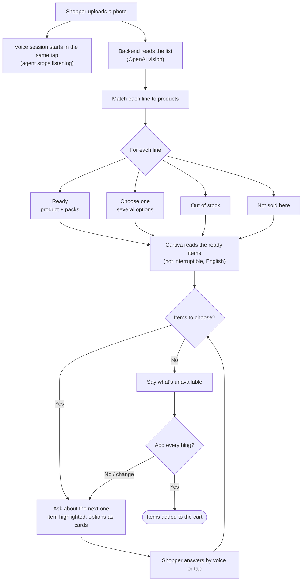
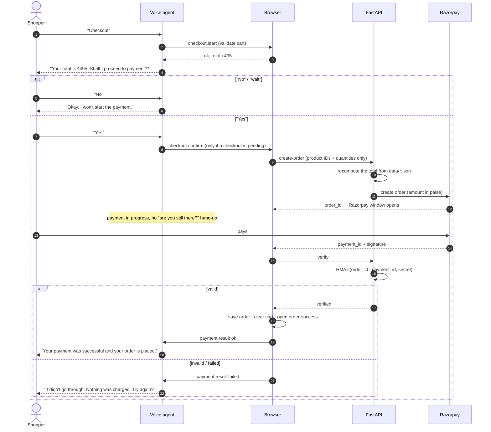
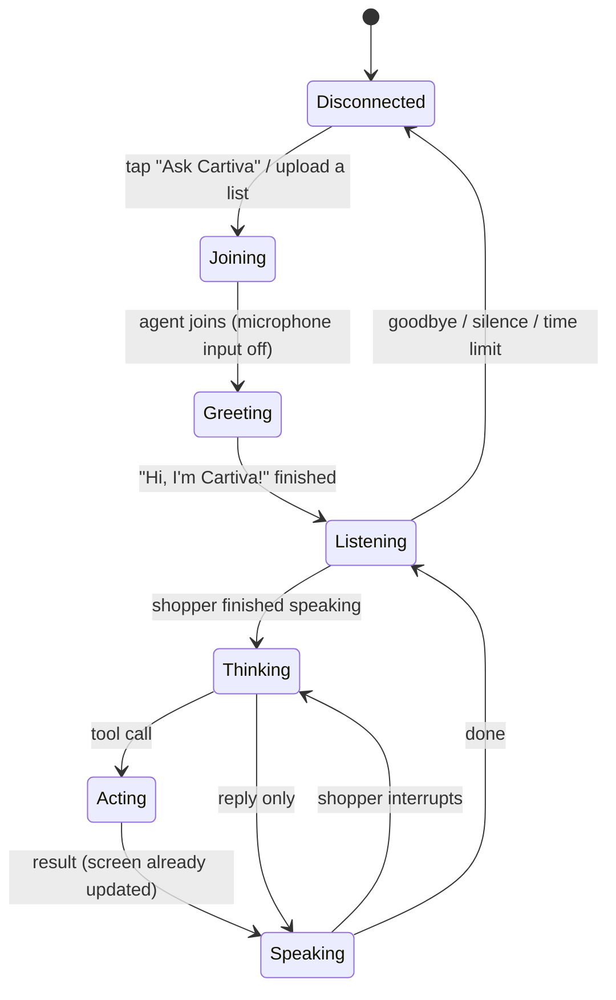

# Cartiva — shop groceries just by talking

**Cartiva is a grocery store you can shop by voice.** It's a complete online store, and on top of it sits a
real-time voice assistant that **operates the app itself**: it opens pages, finds products, adds them to your
cart and checks out, while you watch it happen on screen.

> **Voice is not a separate chatbot.** It's a second way to use the same app. Every voice action calls the
> same controllers and services as the buttons, so voice and taps always share one cart, one set of prices and
> one set of rules.

---

## Contents
- [Features](#-features)
- [How it works](#-how-it-works)
- [Flowcharts](#-flowcharts)
- [Voice tools](#-voice-tools)
- [Tech stack](#-tech-stack)
- [Project structure](#-project-structure)
- [Getting started](#-getting-started)
- [Testing](#-testing)
- [Status and limitations](#-status-and-limitations)

---

## ✨ Features

### 🛍️ A complete grocery store (works without voice)
- **Catalogue:** 67 products in 9 categories (vegetables, fruits, dairy, beverages, snacks, breakfast,
  cleaning, laundry, personal care), loaded from JSON and validated at startup.
- **Browse:** home page with categories, offers and bestsellers; category pages; product pages; related products.
- **Search, filter, sort:** partial matches and plurals ("tom" → tomato, "liquids" → liquid); filter by price,
  brand and availability; sort by price or name.
- **Product cards:** price per kg / litre / piece, low-stock and out-of-stock badges, an **ADD** button that turns
  into a quantity stepper.
- **Product page:** buy box with the real cart quantity, delivery and payment info, and the offers that product
  counts toward.

### 🛒 Cart and pricing
- Add, remove and change quantities, with **live stock limits**.
- **Offers applied automatically:** category discounts (10% off vegetables over ₹300, 15% off laundry over ₹500)
  and a whole-cart discount (₹50 off over ₹999). Inactive offers never apply.
- **Free delivery** above ₹499 (₹30 otherwise).
- **"Unlock more savings"** progress bars show how close you are to free delivery or the next offer.
- **"You might also like"** suggestions from the same aisles.
- Item count = number of different products (2 kg of tomatoes is 1 item).
- The cart is saved in the browser and survives a reload.

### 💳 Checkout and payments
- Step tracker: **Cart → Review → Pay → Done**.
- **No payment starts without an explicit confirmation**, by tapping "Confirm & pay" or a spoken "yes".
- **Razorpay** checkout (UPI, cards, netbanking, wallets) in test mode.
- **The server recomputes the total** from the catalogue and **verifies Razorpay's signature (HMAC)** before an
  order counts as paid. A total sent by the browser is never trusted.
- Clear failure state: "Nothing was charged, your cart is saved", plus **Try again**.
- Order success page with the order reference.

### 🎙️ A voice assistant that operates the app
- **Natural commands:** "Show me vegetables", "Add 2 kg potatoes", "Dishwashing liquid under ₹200",
  "Which one is cheapest?", "Add that one", "What's my total?", "Checkout".
- **Understands context:** "that one", "the cheapest", "the second one" refer to what's on your screen.
- **Never guesses:** for an unclear request ("Add Surf Excel") it highlights the options and asks which one.
- **Honest about stock:** says when something is out of stock, or offers the quantity that's left.
- **Never claims what it didn't do:** it only says "added" after the cart action actually succeeded.
- **Stays on your page:** "Add onions" while you're on Vegetables adds them without navigating away.
- **Keeps it short:** opening a category or a search says how many products are on screen, not a long list.
- **Opens the scan page** when you say "I want to scan a list".
- **Safe checkout by voice:** reads the total, waits for a clear "yes"; "no" cancels.
- **Announces the result:** "Your payment was successful and your order is placed."
- Introduces itself first ("Hi, I'm Cartiva!") before it starts listening, and only once per call.

### 🖥️ "Agentic" UI: you see the assistant work
- A **glowing cursor** travels to the product and "clicks" it; the cart changes when it lands.
- Products **fly into the cart**; the badge and totals roll up.
- Cards light up when the assistant scans results, picks one, offers options, or hits a stock problem.
- Search results **stream in** one by one; a progress beam shows when the assistant opens a page.
- A **voice sphere** with waves that react to who is speaking, and a one-line caption of what the assistant is
  doing. **No chat window.**
- The screen updates **before** the assistant speaks, so you never hear "done" before you see it.

### 📸 Scan a handwritten shopping list
- Take a photo of a list; it's read (OpenAI vision) and matched to products automatically.
- Each line is sorted into **ready**, **choose one**, **out of stock** or **not sold here**.
- Cartiva **reads the list out without being interrupted**, then asks about unclear items **one at a time**. The
  item it's asking about is **highlighted on screen** with its options as tappable cards.
- It then says what's unavailable and fills the cart after one **"yes"**.

### 🇮🇳 English, Hindi and Hinglish
- Replies in the language you speak, turn by turn. **English by default.**
- Both the words and the voice switch, so quantities and prices are spoken in the same language.

### ✅ Experience and reliability
- Bright, food-first design with an optional **dark mode**; responsive from phones to wide screens.
- Page transitions, scroll reveals and micro-interactions, all respecting **reduced motion**.
- Accessible: keyboard navigation, screen-reader labels, visible focus.
- Clear messages for every failure (microphone blocked, assistant unavailable, connection lost, payment failed).
  **Tapping always keeps working.**

---

## 🧠 How it works

Cartiva has three running parts and no database:

| Part | Role |
|---|---|
| **Frontend** (`frontend/`) | The store: catalogue, cart, pricing, checkout. It also exposes the **actions the voice assistant can call** (over LiveKit RPC) and runs Razorpay Checkout. |
| **Backend** (`backend/app/`) | FastAPI: voice session tokens, Razorpay order creation and verification (total recomputed on the server), shopping-list scanning. |
| **Voice agent** (`backend/agent/`) | LiveKit agent: speech-to-text → AI model → voice, plus the shopping tools. It never owns a cart; every tool calls the browser. |



### Architecture rules
1. **The agent never owns a cart or a catalogue.** Each voice tool calls a browser action, which calls the same
   controller and service the buttons use.
2. **The browser tells the agent what's on screen** (page, products, cart), so "the cheapest one" works after
   you browsed by tapping.
3. **The agent never takes payment.** It can only open checkout after an explicit "yes".
4. **The backend owns all secrets.** The browser only gets a LiveKit token and the Razorpay key ID.
5. **Payment totals are recomputed on the server.**

### Code layers (MVC + SOLID)
Mutations always flow **View → Controller → Service → Storage interface → Store**.



| Principle | How it's applied |
|---|---|
| **S**ingle responsibility | Repositories read data, services hold rules, stores hold state, views render. |
| **O**pen/closed | A new discount type is a new strategy; Razorpay is a new `PaymentGateway`. |
| **L**iskov | The mock and Razorpay gateways, or JSON and future database repositories, are interchangeable. |
| **I**nterface segregation | Small interfaces: `ProductRepository`, `OfferRepository`, `CartStorage`, `PaymentGateway`. |
| **D**ependency inversion | Services receive interfaces through constructors, wired in `lib/container.ts`. |

---

## 🔀 Flowcharts

### 1. One app, two ways to shop


### 2. A voice command, end to end ("Add 2 kg onions")


### 3. Scanning a handwritten list


### 4. Checkout and payment


### 5. Voice session lifecycle


---

## 🧰 Voice tools

Every tool is a thin wrapper that calls a browser action; no business rules live in the agent.

| Tool | What it does |
|---|---|
| `search_products` | Search the catalogue (optionally by price); shows results on screen, or looks up silently when only an ID is needed |
| `navigate_category` | Open a category page |
| `open_product` | Open a product page |
| `open_page` | Open the cart, home or scan-list page |
| `get_screen` | Read what's on screen (for "the cheapest one", "the second one") |
| `highlight_products` | Point at one product, or ring several as options |
| `add_to_cart` / `remove_from_cart` / `update_cart` | Change the cart with the same stock rules as the buttons |
| `get_cart` | Read the cart and the bill |
| `start_checkout` | Validate the cart and ask for confirmation (never pays) |
| `confirm_payment` | Open payment, only after an explicit "yes" |
| `cancel_pending_action` | "No", "wait", "never mind" |
| `get_shopping_list` | Read the scanned list |
| `choose_list_item` / `update_list_item` / `remove_list_item` / `add_list_item` | Edit the scanned list |
| `confirm_shopping_list` | Add the ready list items to the cart (after a "yes") |
| `end_call` | Say goodbye and hang up |

---

## 🛠️ Tech stack

| Area | Technology |
|---|---|
| Frontend | Next.js 16 (App Router), React 19, TypeScript, Tailwind CSS v4, Zustand, Motion |
| Backend | Python 3.12, FastAPI, uv |
| Voice | LiveKit Cloud + LiveKit Agents; Deepgram Nova-3 (speech-to-text), GPT-4.1 mini (AI model), Cartesia Sonic-3 (voice) |
| List scanning | OpenAI vision (GPT-4.1 mini) |
| Payments | Razorpay (test mode) with server-side signature verification |
| Tests | Vitest (frontend), pytest (backend) |

---

## 📁 Project structure

```text
cartiva/
├── frontend/                 # Next.js app
│   ├── app/                  # View — routes (home, category, product, search, cart, checkout, scan-list, order-success)
│   ├── components/           # View — UI (products, cart, checkout, voice, agent effects, shopping list)
│   ├── hooks/                # View — read-only view models
│   ├── controllers/          # Controllers — UI and voice entry points
│   ├── services/             # Business rules — catalogue, pricing, cart, checkout, payment, shopping lists
│   ├── models/               # Entities + repository interfaces (JSON / Zustand implementations)
│   ├── store/                # Zustand state containers
│   ├── lib/                  # Composition root (container.ts), voice RPC wiring
│   └── data/                 # products.json, categories.json, offers.json, delivery.json, pricing-cases.json
├── backend/
│   ├── app/                  # FastAPI: LiveKit token, Razorpay, list scanning
│   ├── agent/                # LiveKit voice agent: worker.py, rpc.py, language.py
│   └── tests/                # pytest
├── PRD.md · PLAN.md · SRS-PRD.md   # Product requirements and build plan
└── README.md
```

---

## 🚀 Getting started

### Prerequisites
- **Node.js 20+** and npm
- **Python 3.12+** and **[uv](https://docs.astral.sh/uv/)**
- A **[LiveKit Cloud](https://cloud.livekit.io)** project (URL, API key, API secret)
- **[Razorpay](https://dashboard.razorpay.com)** test keys
- An **OpenAI API key** (used for reading shopping-list photos)

### 1. Configure
```bash
# Backend
cd backend
cp .env.example .env        # fill in LIVEKIT_*, RAZORPAY_*, OPENAI_API_KEY

# Frontend
cd ../frontend
cp .env.example .env.local  # NEXT_PUBLIC_BACKEND_URL=http://127.0.0.1:8000
```

| Variable | Where | Purpose |
|---|---|---|
| `LIVEKIT_URL`, `LIVEKIT_API_KEY`, `LIVEKIT_API_SECRET` | `backend/.env` | Voice sessions and the agent |
| `RAZORPAY_KEY_ID`, `RAZORPAY_KEY_SECRET` | `backend/.env` | Payments (use `rzp_test_…` keys) |
| `OPENAI_API_KEY`, `OPENAI_VISION_MODEL` | `backend/.env` | Reading shopping-list photos |
| `CARTIVA_MAX_SESSION_SECONDS` | `backend/.env` (optional) | Voice session limit, default 300 |
| `NEXT_PUBLIC_BACKEND_URL` | `frontend/.env.local` | Where the FastAPI backend runs |

### 2. Install
```bash
cd frontend && npm install
cd ../backend && uv sync
```

### 3. Run (three terminals)
```bash
# 1 — Backend API (http://127.0.0.1:8000)
cd backend
uv run fastapi dev app/main.py

# 2 — Voice agent (run only ONE worker at a time)
cd backend
uv run python -m agent.worker dev

# 3 — Frontend (http://localhost:3000)
cd frontend
npm run dev            # or: npm run build && npm start (smoother, recommended for demos)
```

Open **http://localhost:3000**, tap **Ask Cartiva**, allow the microphone, and start talking.

### Test payment (Razorpay test mode, no real money)
| Field | Value |
|---|---|
| Card | `4100 2800 0000 1007` |
| Expiry / CVV | any future date / any 3 digits |
| Bank page | click **Success** (or **Failure** to test the error path) |

### Try saying
- "Show me vegetables" → "Add 2 kg potatoes"
- "Dishwashing liquid under 200 rupees" → "Which one is cheapest?" → "Add that one"
- "Add Surf Excel" (it asks which one)
- "I want to scan a list" (upload a photo of: *Surf Excel, Coriander, Garlic*)
- "Mujhe ek kilo tamatar chahiye" (Hinglish)
- "What's my total?" → "Checkout" → "Yes"

---

## 🧪 Testing

```bash
# Frontend: pricing, cart, catalogue, checkout, shopping lists, agent effects (100+ tests)
cd frontend
npm test
npm run lint

# Backend: pricing, payments, shopping lists, language detection, speech keyterms
cd backend
uv run pytest tests/test_pricing.py tests/test_payment.py tests/test_shopping_list.py tests/test_language.py tests/test_stt_keyterms.py
```

`backend/tests/test_conversation.py` runs real conversations through the AI model. It **uses LiveKit
Inference credit**, so run it only when needed.

Pricing has **shared golden cases** (`frontend/data/pricing-cases.json`) checked by both the TypeScript and the
Python implementation, so the browser and the server always agree on totals.

---

## 📌 Status and limitations
- ✅ Store, cart, offers, checkout, Razorpay test payments, voice shopping, agentic UI, list scanning, English /
  Hindi / Hinglish.
- 🔜 **Deploy the voice agent to LiveKit Cloud.** It currently runs locally, so its voice depends on the laptop's
  CPU and network. Hosting it removes that.
- 🔜 Real product photos (current images are stock photos).
- ℹ️ No database or user accounts: the cart lives in the browser, and the last order in the session.
- ℹ️ On LiveKit's free plan, the speech and voice quota can run out after heavy testing. The app keeps working by
  tapping; voice returns when the quota resets.

---

Built as a portfolio project to explore real-time voice agents that **use** an app instead of just talking
about it.
