# Cartiva — How Every Request Works

Each section has a flowchart, a real example, and a step-by-step explanation. Every box in a
flowchart names the file that does that step.

**Colours:** 🟪 Shopper · 🟩 Frontend (Next.js) · 🟧 Backend (FastAPI) · 🟣 Voice agent (Python) ·
🔵 LiveKit Cloud · 🩵 RPC bridge · 🟥 error / alternative · 🟢 success
**Shapes:** ◆ = a decision · side boxes = what happens on the other branch

> To change a diagram: edit `docs/diagrams/make_diagrams.py`, then run
> `python docs/diagrams/make_diagrams.py docs/diagrams` from the repo root.

---

## Quick lookup: request → tool → browser method → code

| Shopper says | Agent tool (`backend/agent/worker.py`) | RPC method (`frontend/lib/voice/rpc.ts`) | Code that does the work |
|---|---|---|---|
| "Show me tomatoes", "dishwash under 200" | `search_products` | `catalog.search` | `voiceController.searchProducts` → `catalogService.filter` |
| "Add 2 kg tomatoes" | `add_to_cart` | `cart.add` | `cartController.add` → `cartService.add` |
| "What's in my cart?", "What's my total?" | `get_cart` | `cart.get` | `cartService.getCart` |
| "Remove the milk" | `remove_from_cart` | `cart.remove` | `cartController.remove` |
| "Make it 3", "one more" | `update_cart` | `cart.update` | `cartController.updateQuantity` |
| "Go to fruits" | `navigate_category` | `ui.openCategory` | `voiceController.openCategory` + router |
| "Open the Pril one" | `open_product` | `ui.openProduct` | `voiceController.openProduct` + router |
| "Add the cheapest one" (after clicking) | `get_screen` | `ui.getScreen` | `screenController.current` |
| "Checkout" | `start_checkout` | `checkout.start` | `checkoutService.validate` |
| "Yes" (after the total) | `confirm_payment` | `checkout.confirm` | `checkoutController.confirmAndPay` |
| "No", "wait", "रहने दो" | `cancel_pending_action` | — (agent only) | clears the pending-checkout flag |
| "Bye", "बस, धन्यवाद" | `end_call` | — (agent only) | says goodbye, deletes the room |
| "What's on my list?" (after a scan) | `get_shopping_list` | `list.get` | `useShoppingListStore` lines |
| "Remove the bread" | `remove_list_item` | `list.remove` | `shoppingListController.remove` |
| "Add two packets of chips" | `add_list_item` | `list.add` | `shoppingListController.add` → `shoppingListService.toLine` |
| "Make the tomatoes three" | `update_list_item` | `list.update` | `shoppingListController.setPacks` |
| "The 2 kg Surf Excel" | `choose_list_item` | `list.choose` | `shoppingListController.choose` |
| "Yes, add them" | `confirm_shopping_list` | `list.confirm` | `shoppingListController.confirm` → `cartService.add` |

**Browser → agent messages** (the reverse direction): `payment.result` (a payment finished) and
`list.scanned` (a shopping list was scanned), sent with `notifyAgent` in `frontend/lib/voice/rpc.ts`.

**The one rule behind all of them:** the agent **decides**, the browser **does** — using the same
controllers and services as the buttons — and FastAPI **guards the secrets**.

---

## 0 · The big picture

Three programs work together:

1. **Frontend (Next.js, port 3000)** — the shop itself: products, cart, pricing, checkout.
2. **Backend (Python, port 8000)** — FastAPI signs LiveKit tokens (it holds the secret), and the
   **voice agent** runs as a separate worker process.
3. **LiveKit Cloud** — the "phone line": a room carries audio between the browser and the agent,
   plus the RPC messages; LiveKit Inference runs the AI models (STT, LLM, TTS).

---

## 1 · Clicking "Add to cart" (no voice)

This is the foundation every voice action reuses.

1. **View** — the ADD button calls the controller (views never contain business rules).
2. **Controller** — `cartController.add` is the entry point; it shows the toast afterwards.
3. **Service** — `cartService.add` checks the rules: product exists, in stock, enough units.
4. **Store** — the cart (only ids + quantities) is saved in Zustand + localStorage.
5. **Pricing** — `pricingService` recalculates in **paise** (₹1 = 100 paise) to avoid rounding errors.
6. **Result** — the cart icon updates and a toast confirms; on failure a red toast explains why.

---

## 2 · Starting a voice session

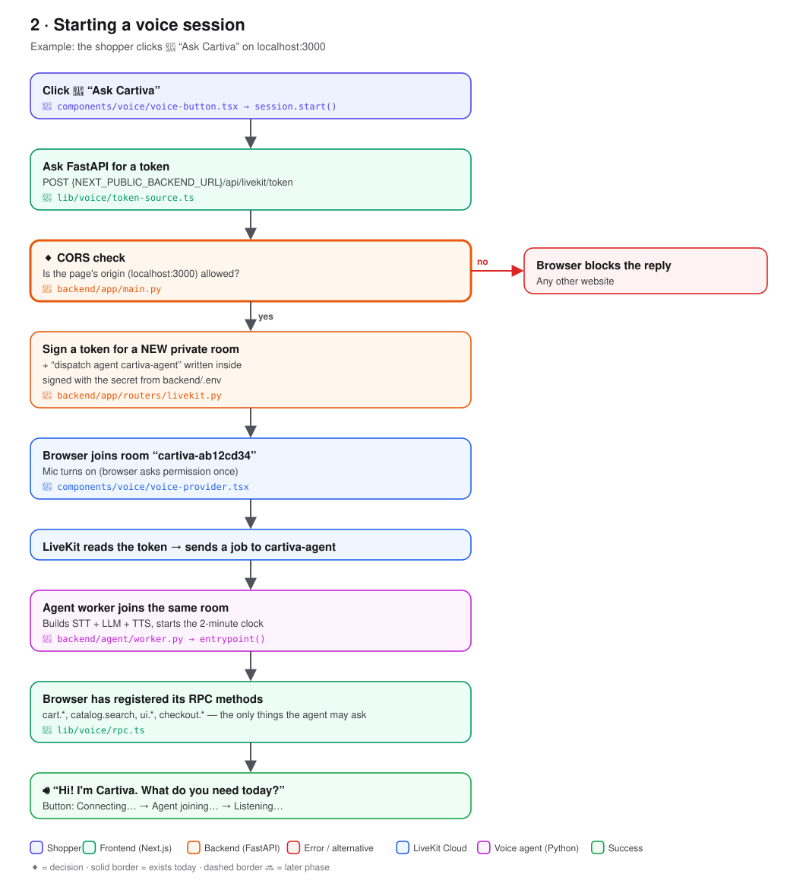

1. The 🎤 button calls `session.start()`.
2. The browser asks **FastAPI** for a token (`POST /api/livekit/token`).
3. **CORS:** FastAPI only answers pages from allowed origins (`localhost:3000`).
4. FastAPI creates a **new private room** and signs a token with the secret. The token also says
   **"dispatch cartiva-agent"** — because the agent has a name, LiveKit only sends it when asked.
5. The browser joins the room and turns on the mic.
6. LiveKit reads the token and sends a **job** to your agent worker.
7. The agent joins the same room, builds its voice pipeline and starts the 2-minute clock.
8. The browser has registered its **RPC methods** — the complete list of things the agent may ask.
9. The agent greets in English: "Hi! I'm Cartiva…". The button shows each state on the way.

---

## 3 · What happens in one voice turn

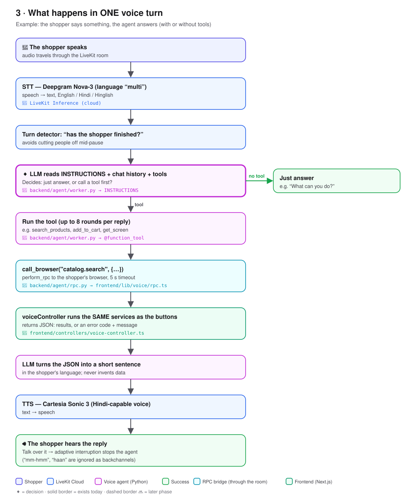

Every request below follows this shape:

1. **STT** (Deepgram Nova-3, `multi`) turns speech into text — English, Hindi or mixed.
2. The **turn detector** waits until the shopper has really finished speaking.
3. The **LLM** reads the instructions, the conversation so far and the tool list, then decides:
   just answer, or call a tool first.
4. A **tool** (Python) calls the browser through the **RPC bridge** (`call_browser`, 5 s timeout).
   Up to 8 tool rounds are allowed per reply (`MAX_TOOL_STEPS`).
5. The browser's **voiceController** runs the **same services as the buttons** and returns JSON.
6. The LLM turns that JSON into one or two sentences — in the shopper's language, never inventing data.
7. **TTS** (Cartesia Sonic 3) speaks it.
8. If the shopper talks over it, **adaptive interruption** stops the agent — but "mm-hmm" / "haan"
   are recognised as listening noises, not interruptions.

---

## 4 · Searching by voice

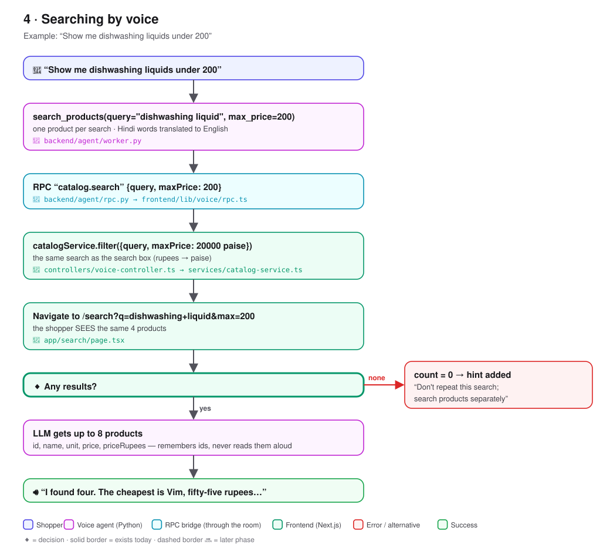

1. The LLM calls `search_products` with **one product**, in **English** (Hindi words are translated),
   and a price limit only if the shopper gave one.
2. The browser runs `catalogService.filter` — the same search as the search box (rupees → paise).
3. The browser **navigates** to `/search?q=…&max=…`, so the shopper sees the same results.
4. The agent receives up to 8 products with ids and numeric prices, remembers the ids, never says them.
5. **No results?** The tool adds a hint: don't repeat the search; search products separately.
   (Our tests found the LLM once searched "tomato potato" nine times — this hint stops that.)

---

## 5 · Adding to the cart by voice

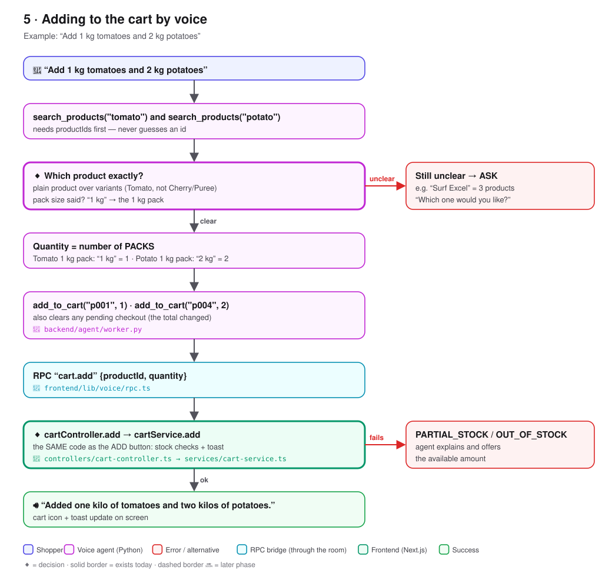

1. The agent **searches first** — it never guesses a product id.
2. **Which product?** It prefers the plain product over variants ("tomatoes" → Tomato, not Tomato
   Cherry or Tomato Puree) and uses the pack size the shopper said. If it is still unclear
   (e.g. three Surf Excel products and no size), it **asks**.
3. **Quantity = number of packs:** "2 kg potatoes" with a 1 kg pack → quantity 2.
4. `add_to_cart` → RPC `cart.add` → `cartController.add` — **the same code as the ADD button**, so
   stock checks, the toast and the cart icon all behave identically.
5. If stock is short, the agent explains and offers what is available.
6. Adding anything also **clears a pending checkout**, because the total changed (see section 9).

---

## 6 · Removing items and changing quantities

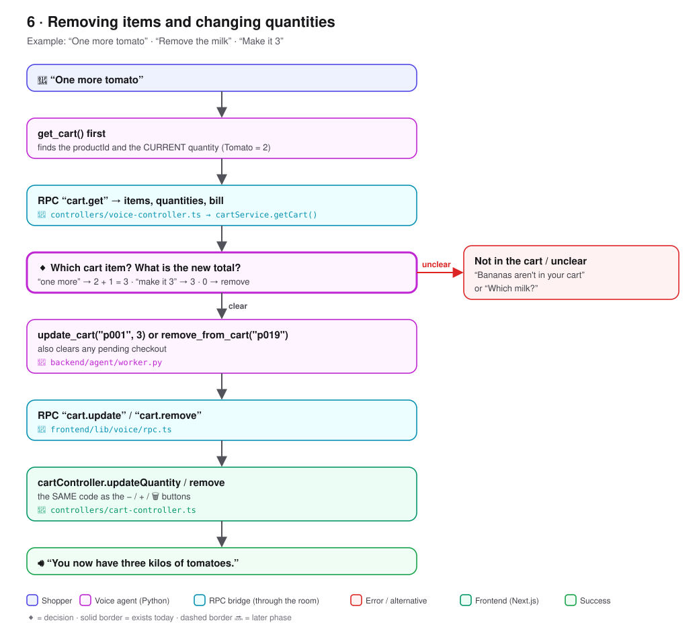

1. The agent first calls `get_cart` to find the right product id and the **current** quantity.
2. It works out the new total itself: "one more" → current + 1, "make it 3" → 3, 0 → remove.
3. `update_cart` / `remove_from_cart` → the same controller as the − / + / 🗑 buttons.
4. If the item isn't in the cart, or several items could match, it says so or asks.

---

## 7 · Moving around the website by voice

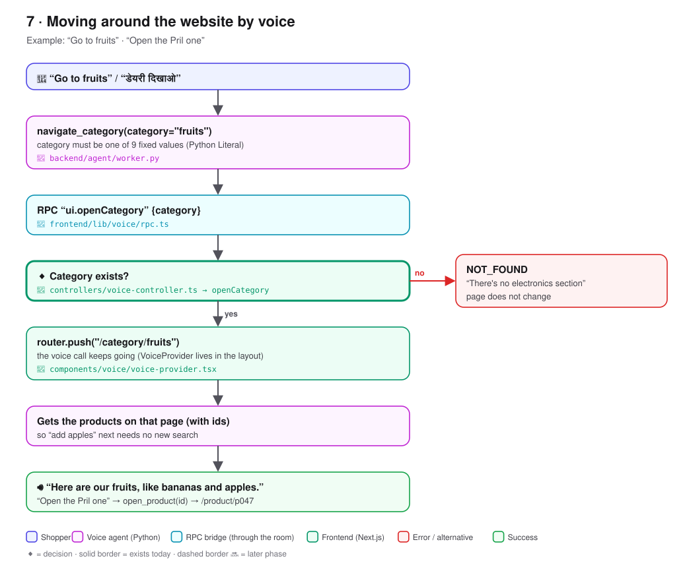

1. `navigate_category` only accepts the 9 real categories — a Python `Literal` gives the LLM a fixed
   choice list, so it can't invent one.
2. The browser checks the category and calls `router.push(...)`. The call keeps going, because the
   voice session lives in the **layout**, which never unmounts.
3. The agent receives the products on that page (with ids), so "add apples" next needs no new search.
4. `open_product` works the same way for one product page.

---

## 8 · "The cheapest one" after browsing by clicking

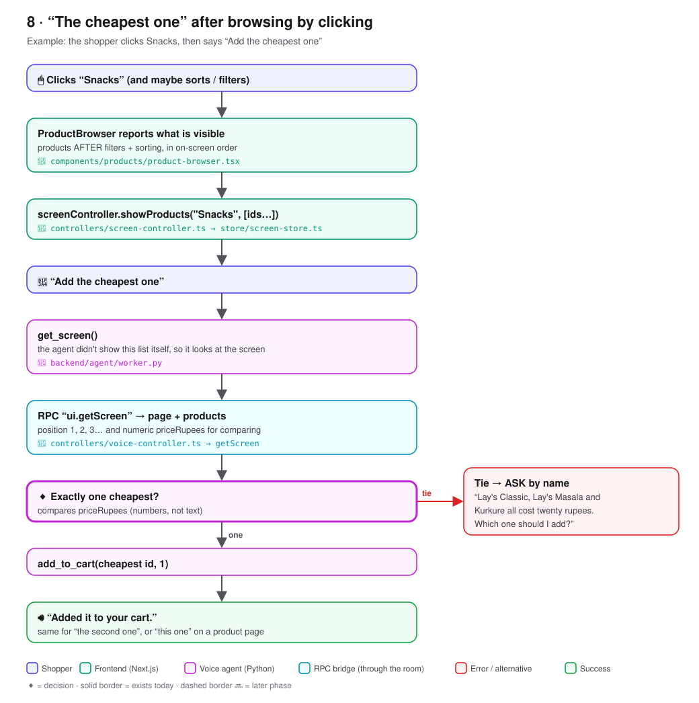

The agent only knows what **it** did — so the browser also records what the shopper sees.

1. Whenever the product list changes (new page, filter, sort), `ProductBrowser` reports the visible
   products **in on-screen order** to `screenController` (stored in `screen-store`).
2. When the shopper refers to something on screen, the agent calls `get_screen`.
3. It gets positions (1, 2, 3…) and **numeric** prices, so "cheapest" and "the second one" are exact.
4. **Ties:** if two or more products share the cheapest (or most expensive) price, it names them and
   asks which one — it never picks by itself. (Snacks has a 3-way tie at ₹20.)
5. If the shopper has moved to a page without products (e.g. the cart), the screen is empty and the
   agent asks what they mean.

---

## 9 · Checkout by voice — never pays without "yes"

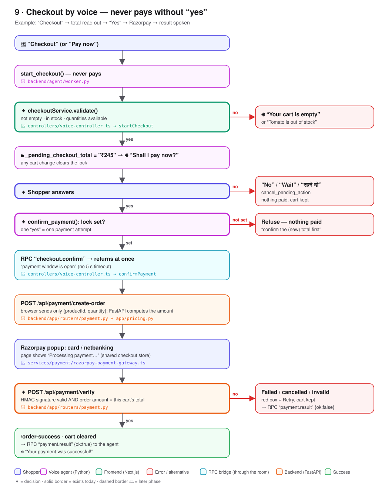

Money needs rules the LLM cannot skip, so **Python enforces them**:

1. "Checkout" → `start_checkout` only **validates** the cart and opens `/checkout`. It never pays.
2. If valid, Python sets a lock: `_pending_checkout_total = "₹245"`, and the agent reads out the total.
3. **No / wait / रहने दो** → `cancel_pending_action` clears the lock; nothing is paid.
4. **Yes** → `confirm_payment` checks the lock **in Python**:
   - not set (no checkout, or the cart changed since) → refuses, nothing paid;
   - set → clears it first (one "yes" = one payment attempt), then opens the payment.
5. The browser's `checkout.confirm` **returns at once** ("the payment window is open"), because typing
   card details takes longer than an RPC may wait.
6. Payment uses the **same call as the Pay button** (`checkoutController.confirmAndPay`):
   - the browser sends **only product ids and quantities** to `POST /api/payment/create-order`;
     FastAPI recalculates the total (Python pricing, tested against the same `pricing-cases.json`);
   - the **Razorpay popup** opens; the page shows "Processing payment…" from the shared checkout store;
   - `POST /api/payment/verify` accepts it only if the **HMAC signature is valid** and the Razorpay
     order's **amount equals this cart's total** (so a cheap payment can't be reused for a big cart).
7. The result appears on screen (order success, or the red box with Retry) **and** is sent to the agent
   as `payment.result`, so it says "payment successful" or offers to try again.

---

## 10 · How a voice call ends

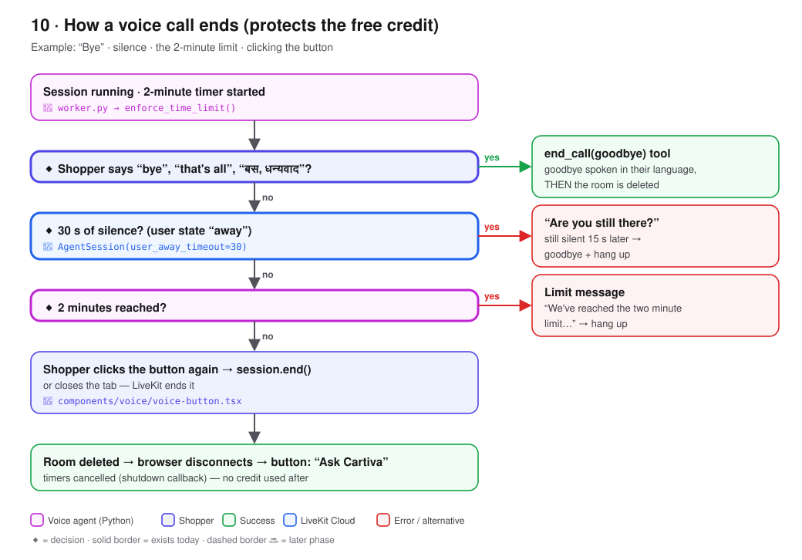

Four ways, all of which stop credit usage:

1. **"Bye" / "बस, धन्यवाद"** → the `end_call` tool speaks a goodbye in the shopper's language, waits
   until it has finished, then deletes the room.
2. **30 s of silence** → "Are you still there?" → still silent 15 s later → goodbye and hang up.
3. **2 minutes** → a limit message, then hang up.
4. **Clicking the button again**, or closing the tab.

Deleting the room disconnects the browser too, so the button returns to "Ask Cartiva". Background
timers are cancelled when the session shuts down.

---

## 11 · Hindi and Hinglish

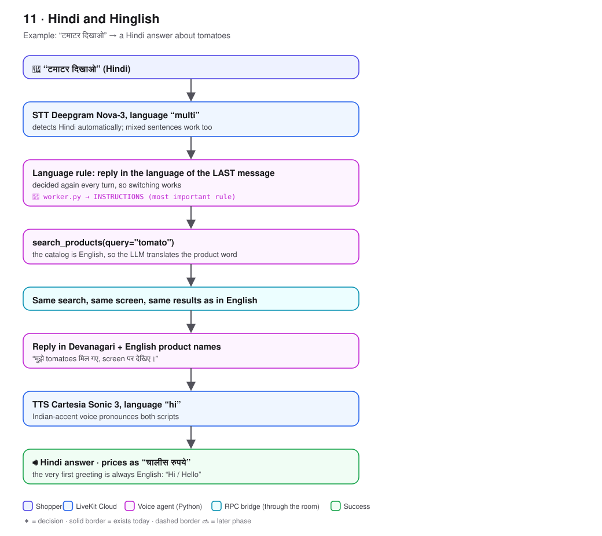

1. STT runs in `multi` mode and detects Hindi, English or a mix by itself.
2. The **most important instruction**: reply in the language of the shopper's **last** message —
   decided again every turn, so switching languages works.
3. The catalog is in English, so the LLM translates product words for the search ("टमाटर" → "tomato").
4. The reply is written in Devanagari with English product names, which the Cartesia Hindi voice
   pronounces well. Prices are spoken as "चालीस रुपये".
5. The very first greeting is always English: "Hi" / "Hello".

---

## 12 · How we test the agent without speaking

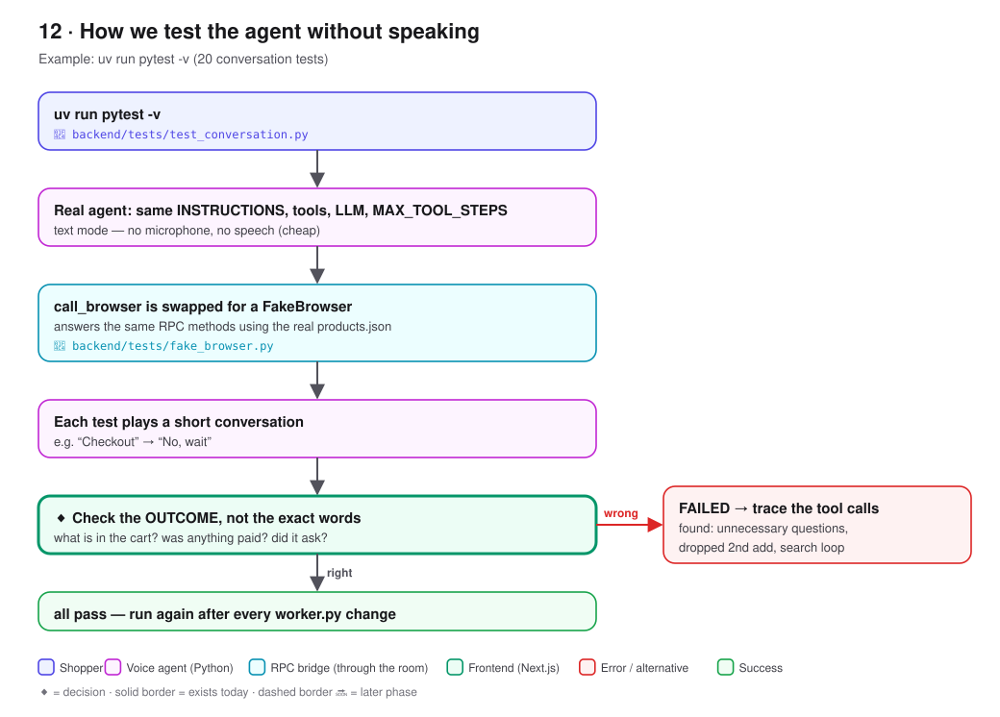

1. `uv run pytest -v` (in `backend/`) runs the **20 conversation tests** (plus the offline pricing,
   payment and list-scan tests).
2. They use the **real** agent — same instructions, tools, LLM and limits — in text mode (no mic,
   no speech, so very little credit).
3. A **FakeBrowser** replaces the website: it answers the same RPC methods using the real catalog.
4. Each test plays a short conversation and checks the **outcome**: what is in the cart, whether
   anything was paid, whether it asked instead of guessing.
5. When a test fails, we trace the tool calls. So far this found three real bugs: an unnecessary
   question ("1 kg tomatoes"), a dropped second item (tool-step limit), and a repeating search.

Run the tests again after **every** change to `backend/agent/worker.py`.

---

## 13 · Scanning a photo of a shopping list

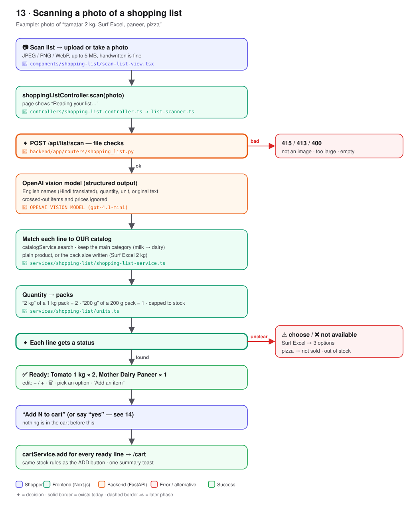

1. **📷 Scan list** (header) opens `/scan-list`. On a phone the file picker opens the back camera.
2. `shoppingListController.scan` uploads the photo to `POST /api/list/scan`.
3. FastAPI checks the file (JPEG / PNG / WebP, at most 5 MB, not empty) and sends it with our
   instructions to the **OpenAI vision model** (`OPENAI_VISION_MODEL`, default `gpt-4.1-mini`).
   **Structured output** makes the model answer in exactly the `ScannedList` shape: English name
   (Hindi translated, e.g. "tamatar" → "tomato"), quantity, unit and the original text.
   Crossed-out items, prices and headings are ignored.
4. The **browser** matches each line to the catalog with the same `catalogService.search` as the rest of
   the site, keeping only the most common category ("milk" → dairy, never the *Dairy Milk* chocolate).
   It picks the plain product ("Tomato", not its variants) or the pack size that was written
   ("Surf Excel 2 kg"); otherwise it asks.
5. Quantities become packs: "2 kg" of a 1 kg pack = 2, "200 g" of a 200 g pack = 1, capped to stock.
6. Each line is **ready**, **choose** (several options) or **not available** (out of stock, or not sold
   here). The shopper can change packs, remove, pick an option or add items.
7. **Nothing is in the cart** until "Add N to cart" (or a spoken "yes"), which uses `cartService.add`
   with the normal stock rules.

The OpenAI key lives only in `backend/.env`; the browser never sees it.

---

## 14 · Reviewing the scanned list by voice

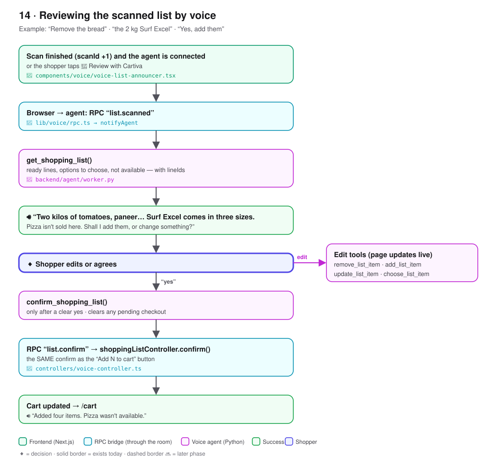

1. When a scan finishes and the voice agent is connected, `VoiceListAnnouncer` sends `list.scanned`
   to the agent — once per scan (`scanId`). Tapping **🎤 Review with Cartiva** starts the call if needed.
2. The agent calls `get_shopping_list` and reads it: ready items with natural amounts, the options
   to choose from, and what is not available.
3. The shopper edits by voice — `remove_list_item`, `add_list_item`, `update_list_item`,
   `choose_list_item` — and the page updates live, because voice and taps use the **same
   `shoppingListController`**.
4. Only after a clear "yes" does the agent call `confirm_shopping_list`, which runs the same confirm as
   the button, opens the cart, and the agent says what was added and what wasn't available.

---

## 15 · When voice goes wrong

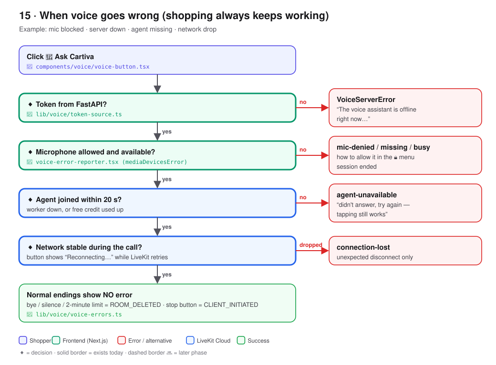

Voice is an extra way to shop, so every failure explains itself and tapping keeps working:

| Problem | How we detect it | Shopper sees |
|---|---|---|
| FastAPI unreachable | `VoiceServerError` from the token source | "The voice assistant is offline right now…" |
| Microphone blocked / missing / busy | the session's `mediaDevicesError` + `MediaDeviceFailure` | How to allow the mic in the 🔒 menu |
| Agent never joins (worker down, credit used up) | `useAgent()` → `failed` after 20 s | "The voice assistant didn't answer…" |
| Network drop | `connectionState` → reconnecting; unexpected `Disconnected` reason | "Reconnecting…", then "connection was lost" |
| Normal endings (bye, silence, 2 min, stop) | `ROOM_DELETED` / `CLIENT_INITIATED` | **No** error |

All messages live in one place: `frontend/lib/voice/voice-errors.ts`.
