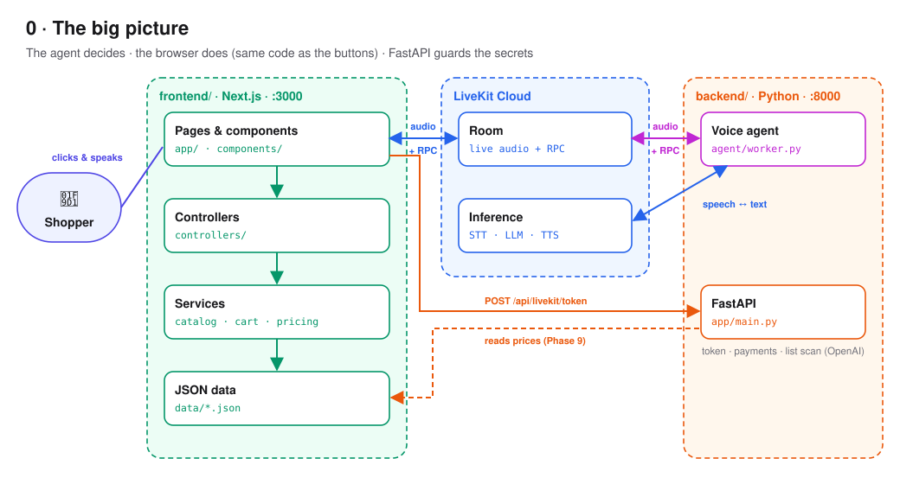
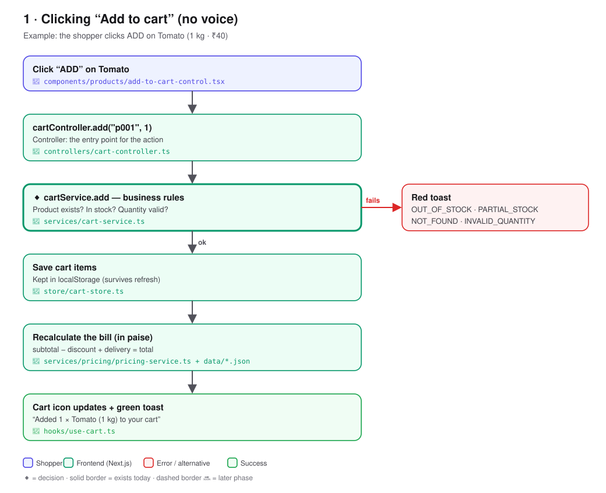
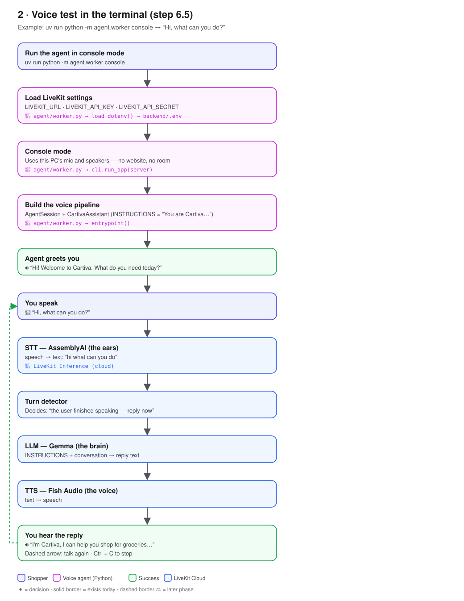
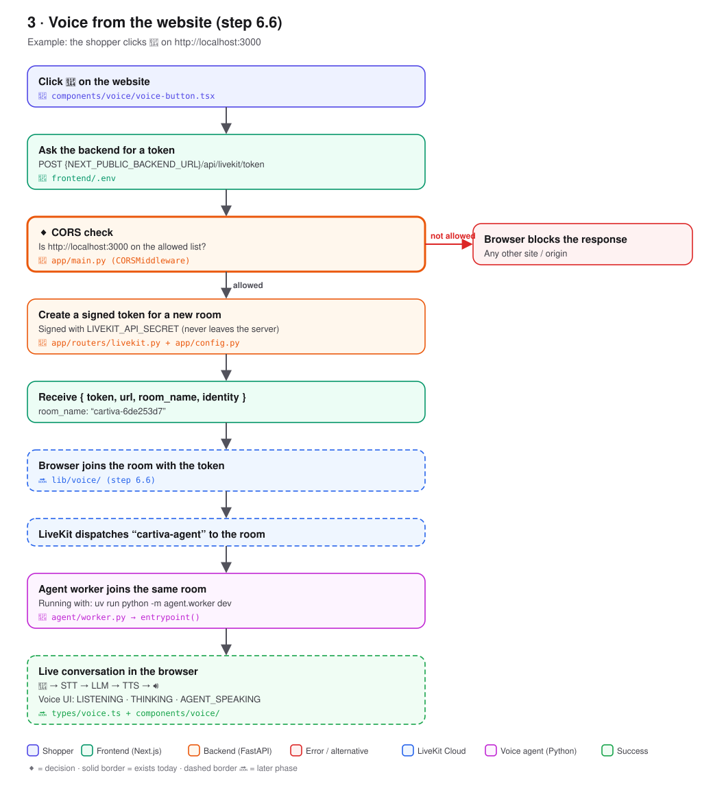
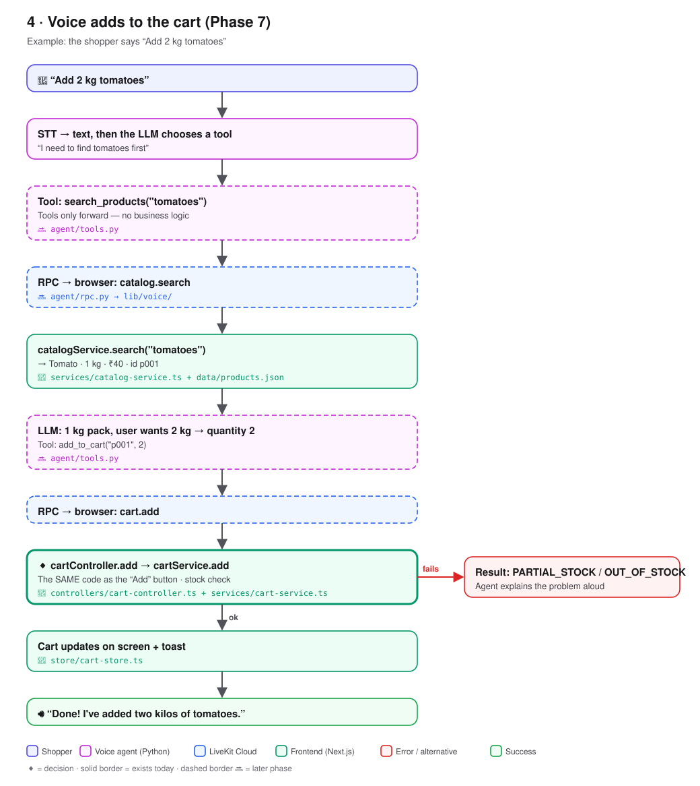
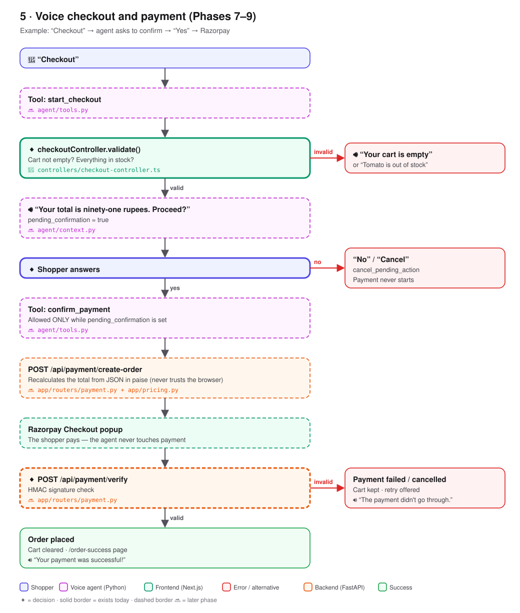

# Cartiva — Flowcharts

Each step shows **what happens** and **which file** does it, using a real example.

**Colours:** 🟪 Shopper · 🟩 Frontend (Next.js) · 🟧 Backend (FastAPI) · 🟣 Voice agent (Python) · 🟦 LiveKit Cloud · 🟥 error / alternative
**Borders:** solid = file exists today · dashed 🔜 = built in a later phase · ◆ = decision

> To change a diagram, edit `docs/diagrams/make_diagrams.py`, then run
> `python docs/diagrams/make_diagrams.py docs/diagrams` from the repo root.

---

## 0 · The big picture

---

## 1 · Manual shopping: "Add to cart" button

---

## 2 · Voice test in the terminal (step 6.5)

---

## 3 · Voice from the website (step 6.6)

---

## 4 · Voice adds to the cart (Phase 7)

---

## 5 · Voice checkout and payment (Phases 7–9)

